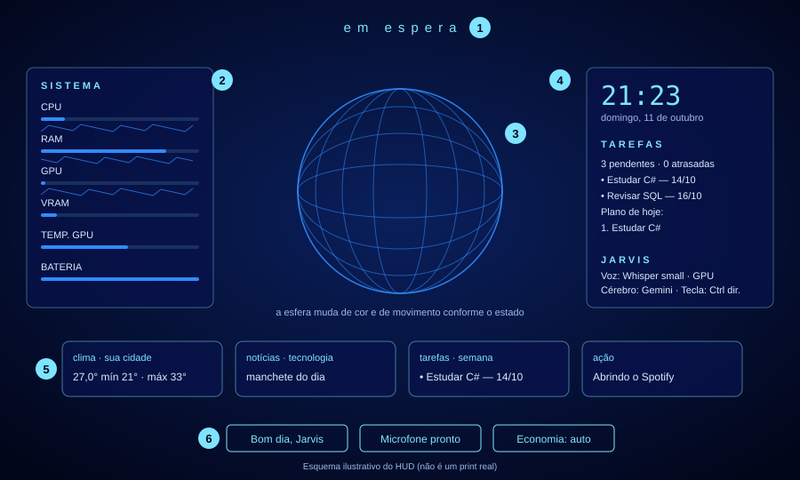
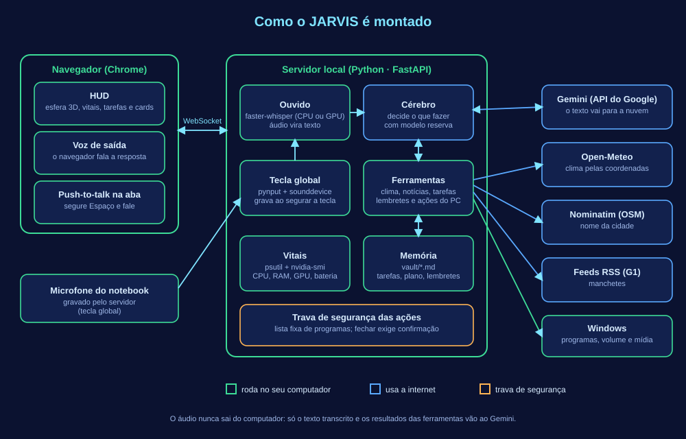
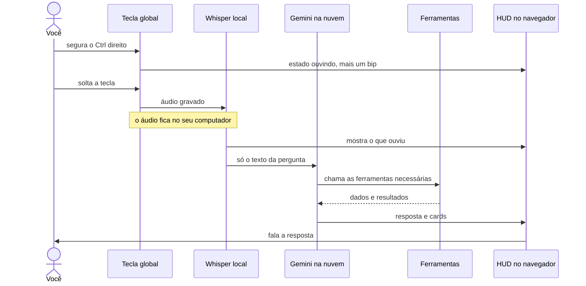
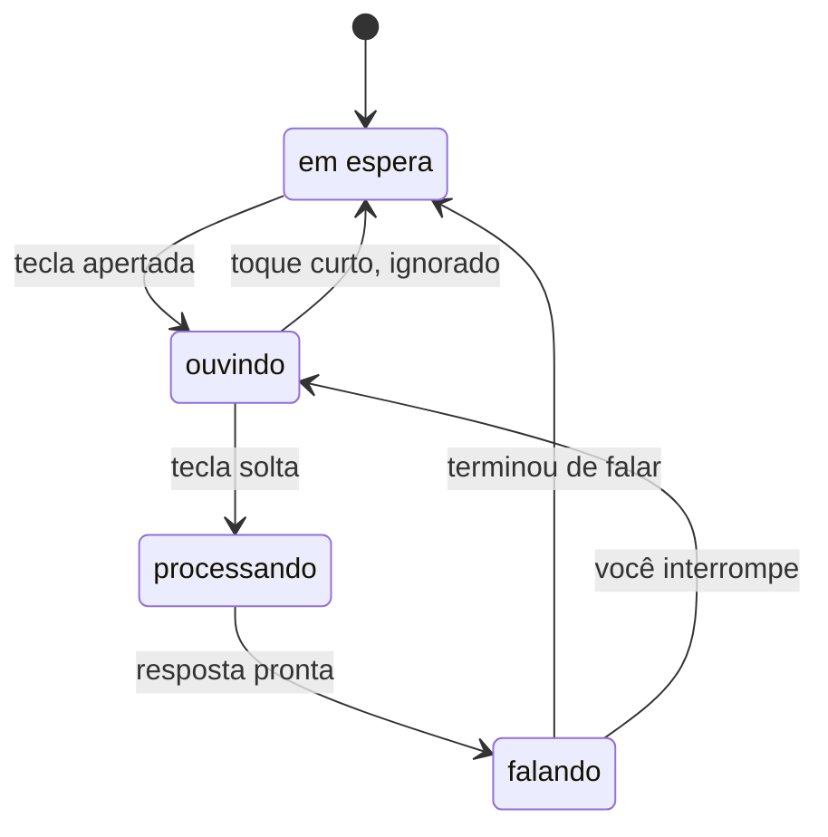
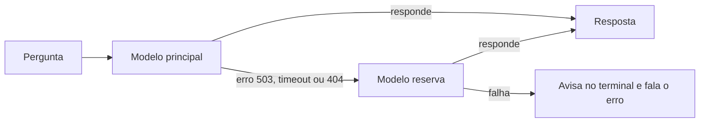
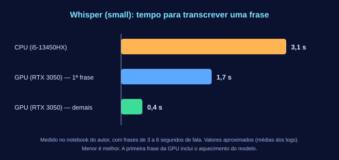
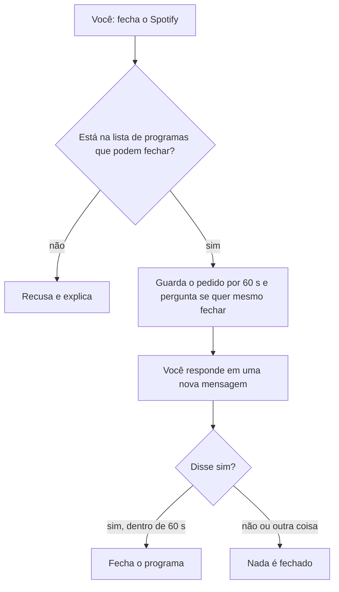
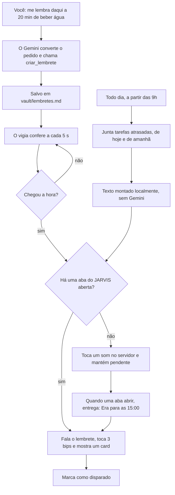

# JARVIS — assistente pessoal por voz para Windows

  

Você segura uma tecla, fala, e o JARVIS responde: consulta clima e notícias, cuida das suas tarefas, avisa de lembretes e prazos, abre programas e mostra tudo num painel (HUD) com uma esfera 3D que reage à sua voz.

> Projeto de estudo, inspirado em assistentes de ficção. Não tem relação com a Marvel, a Disney ou qualquer empresa.



<!-- Quando tiver um print real do HUD, troque a linha acima por:   (antes, esconda dados pessoais como cidade e tarefas) -->

| # | Parte do HUD | O que mostra |
|---|---|---|
| 1 | Estado | em espera, ouvindo, processando ou falando |
| 2 | Sistema | CPU, RAM, GPU, VRAM, temperatura e bateria, com histórico dos últimos ~2 minutos |
| 3 | Esfera 3D | muda de cor e de movimento conforme o estado; reage ao volume da sua voz |
| 4 | Painel lateral | relógio, tarefas, **lembretes e timers com contagem regressiva**, e qual voz/cérebro estão em uso |
| 5 | Cards | clima, notícias, tarefas, ações e alertas, conforme o que aconteceu |
| 6 | Botões | briefing, ativar o microfone e modo de economia |

---

## Como ele é montado



- **Verde:** roda no seu computador (ouvido, tarefas, lembretes, ações, vitais).
- **Azul:** usa a internet (Gemini, clima, nome da cidade, manchetes).
- **Laranja:** a trava que limita o que o JARVIS pode fazer no seu PC.

## O que acontece quando você fala



A tecla global funciona em **qualquer janela**. Dentro da aba do JARVIS, também dá para segurar o **Espaço**.

## Os estados do JARVIS



| Estado | A esfera |
|---|---|
| em espera | gira devagar, azul |
| ouvindo | ciano, reage ao volume da sua voz |
| processando | roxa, gira rápido |
| falando | pulsa junto com a fala |

## Um cérebro com plano B

O Gemini às vezes fica sobrecarregado ou muda de nome. Por isso há um modelo principal e um reserva, e o JARVIS troca sozinho.



## O ouvido: CPU ou placa de vídeo

O áudio é transcrito localmente com [faster-whisper](https://github.com/SYSTRAN/faster-whisper). Com uma placa NVIDIA, a transcrição fica bem mais rápida:



Para usar a placa: `pip install -r requirements-gpu.txt` e, no `.env`, `WHISPER_DEVICE=cuda`. O JARVIS testa a placa num processo separado e, se algo falhar, volta sozinho para a CPU.

## Controle do PC com trava de segurança

O JARVIS só faz o que está em `acoes.py`. Não existe comando livre, apagar ou desligar.

| Tipo | Exemplos |
|---|---|
| Abrir | Visual Studio Code, Spotify, Calculadora, Calendário, YouTube, Claude, Gemini, ChatGPT, Netflix, Explorador |
| Pastas | downloads, documentos, área de trabalho, imagens, vídeos, músicas, pasta do projeto |
| Pesquisar | Google e YouTube |
| Som | volume (aumentar, diminuir, silenciar), pausar/tocar, próxima, anterior |
| Fechar | só Spotify e Calculadora, **com confirmação** |

Fechar um programa é irreversível, então segue este caminho:



A confirmação é controlada pelo **código**, não pelo modelo: a ferramenta recusa um "sim" que venha na mesma mensagem do pedido. Assim, nem um texto malicioso numa notícia consegue mandar o JARVIS fechar algo.

## Tarefas em arquivos Markdown

Nada de banco de dados: suas tarefas ficam em `vault/tarefas.md`, um arquivo de texto que você pode abrir e editar à mão (ou no Obsidian).

```markdown
# Tarefas

- [ ] Estudar C# | prazo: 2026-10-14 | criada: 2026-10-10
- [x] Revisar Java | prazo: 2026-10-16 | matéria: Java | criada: 2026-10-10 | concluída: 2026-10-10
```

O plano do dia vira um arquivo por data em `vault/plano-do-dia/`. A pasta `vault/` está no `.gitignore`, então seus dados não vão para o repositório.

## Lembretes, timers e avisos de prazo

O JARVIS também **fala sozinho**, sem você chamar: quando um timer acaba, na hora de um lembrete e no resumo diário dos prazos das tarefas.

| O que | Exemplo de pedido |
|---|---|
| Timer | "Cria um timer de 5 minutos." · "Timer do macarrão, 10 minutos." |
| Lembrete | "Me lembra daqui a 20 minutos de beber água." · "Me lembra amanhã às 9 horas de estudar C#." |
| Gerenciar | "Quais lembretes eu tenho?" · "Cancela o lembrete de beber água." |
| Prazos | automático, uma vez por dia (às 9h por padrão): tarefas atrasadas, de hoje e de amanhã |

Um **vigia** roda em segundo plano dentro do servidor e confere a cada 5 segundos:



Os lembretes ficam num arquivo de texto, então **sobrevivem a reiniciar o servidor**. Se o computador estava desligado na hora, o JARVIS fala o que ficou pendente na próxima vez que você abrir a aba:

```markdown
# Lembretes

- [x] 2026-10-20 17:05:08 | O timer de 1 minuto terminou. | tipo: timer | id: ecd58bd4 | disparado: 2026-10-20 17:05:10
- [ ] 2026-10-21 09:00:00 | estudar C# | tipo: lembrete | id: 7b21a9f0 | criado: 2026-10-20 18:12:44
```

No `.env`, `JARVIS_AVISO_PRAZOS` muda a hora do aviso diário (vazio desliga) e `JARVIS_ALERTA_SOM=0` desliga o som que o servidor toca quando não há aba aberta.

---

## Requisitos

- Windows 10/11 (as ações do PC e a tecla global são específicas do Windows)
- Python 3.11 ou mais novo (testado com 3.14)
- Microfone e navegador Chrome
- Chave gratuita do [Google AI Studio](https://aistudio.google.com)
- Opcional: placa NVIDIA para acelerar o Whisper

## Instalação

```powershell
git clone https://github.com/rafael-orequio/jarvis-assistente-voz.git
cd jarvis-assistente-voz
python -m venv .venv
.venv\Scripts\Activate.ps1
pip install -r requirements.txt
copy .env.example .env      # depois edite o .env e cole sua chave em GEMINI_API_KEY
uvicorn main:app --reload
```

Abra `http://localhost:8000` no Chrome, clique em **Ativar microfone** e permita o acesso. Na primeira execução o modelo do Whisper é baixado.

**Atalho no Windows:** depois da instalação, dê dois cliques em `iniciar-jarvis.bat` para ligar o servidor e abrir o navegador sozinho.

## Configuração (`.env`)

| Variável | Para que serve |
|---|---|
| `GEMINI_API_KEY` | chave do Google AI Studio |
| `GEMINI_MODEL` / `GEMINI_MODEL_RESERVA` | modelo principal e reserva (os nomes mudam com o tempo; ajuste se der erro 404) |
| `WHISPER_MODEL` / `WHISPER_DEVICE` | tamanho do modelo (`small`, `medium`) e `cpu` ou `cuda` |
| `JARVIS_TECLA` | tecla global: `ctrl_r`, `f9`, `ctrl+space`... |
| `JARVIS_BIP`, `JARVIS_TECLA_GLOBAL` | `0` desliga o bip / a tecla global |
| `JARVIS_AVISO_PRAZOS` | hora do aviso diário de prazos (`09:00`); vazio desliga |
| `JARVIS_ALERTA_SOM` | `0` desliga o som dos lembretes quando não há aba aberta |
| `CIDADE` | opcional, só usada se o navegador não informar a localização |

## Exemplos de comandos

- "Bom dia" (briefing) · "Como está o clima?" · "E as notícias de tecnologia?"
- "Anota uma tarefa: estudar C# na quarta." · "O que eu tenho pra hoje?" · "Monta meu plano do dia."
- "Cria um timer de 5 minutos." · "Me lembra daqui a 20 minutos de beber água." · "Quais lembretes eu tenho?"
- "Abre o Spotify." · "Pesquisa no YouTube música para estudar." · "Aumenta o volume." · "Pausa a música."
- "Fecha o Spotify." (ele pergunta; você confirma com "sim")

## Privacidade e segurança

| Dado | Para onde vai |
|---|---|
| Áudio da sua voz | fica no computador (transcrição local) |
| Texto da transcrição e resultados das ferramentas | API do Gemini (no nível gratuito, o Google pode usar esse conteúdo para melhorar seus produtos; não passe dados sensíveis) |
| Coordenadas da localização | Open-Meteo (clima) e Nominatim/OpenStreetMap (nome da cidade) |
| Tarefas, plano do dia e lembretes | arquivos locais em `vault/`; o texto vai ao Gemini só quando você os cria ou pede para listá-los |
| Aviso diário de prazos | montado localmente, sem passar pelo Gemini |
| Chave da API | arquivo `.env`, fora do Git |

- **Tecla global:** usa `pynput` para observar **somente** a tecla configurada; nada do que você digita é lido nem guardado (veja `voz_global.py`).
- **Ações do PC:** lista fixa em `acoes.py`, sem comando livre, e fechar exige confirmação.
- **Jogos online:** alguns sistemas antitrapaça desconfiam de programas que observam o teclado. Feche o JARVIS antes de jogar.

## Limitações conhecidas

- Só Windows. A voz de saída é a do navegador, e o Whisper erra siglas (há um vocabulário e correções em `main.py`).
- Os alertas falados precisam de uma aba do JARVIS aberta e de **um clique na página** (regra do Chrome para áudio automático).
- Os modelos do Gemini mudam e podem ficar sobrecarregados; por isso existe o modelo reserva.
- Projeto pessoal, sem testes automatizados.

## Estrutura

```
main.py              servidor, ouvido (Whisper), cérebro (Gemini), vigia, vitais
acoes.py             ações do PC (lista fixa)
tarefas.py           tarefas e plano do dia em Markdown
lembretes.py         lembretes, timers e aviso diário de prazos
voz_global.py        tecla global e gravação do microfone
iniciar-jarvis.bat   atalho para ligar tudo no Windows
static/index.html    HUD (esfera 3D, painéis, voz)
docs/                diagramas deste README
```

## Ideias futuras

Voz de saída local, testes automatizados, módulos separados, mais ações e histórico de conversas.

## Licença

[MIT](LICENSE)
